# robo-control

Robot models, controllers and a deterministic simulator for comparing control
laws **per robot body**: wheeled, quadruped, humanoid, arm, drone and
cart-pole. Reference paths come from
[robo-planning](https://github.com/rsasaki0109/robot-planning) (planning by task).

機体（車輪型・犬型・ヒューマノイド・アーム・ドローン・倒立振子）ごとに、
合う制御則を同じタスクで比較シミュレーションするライブラリです。

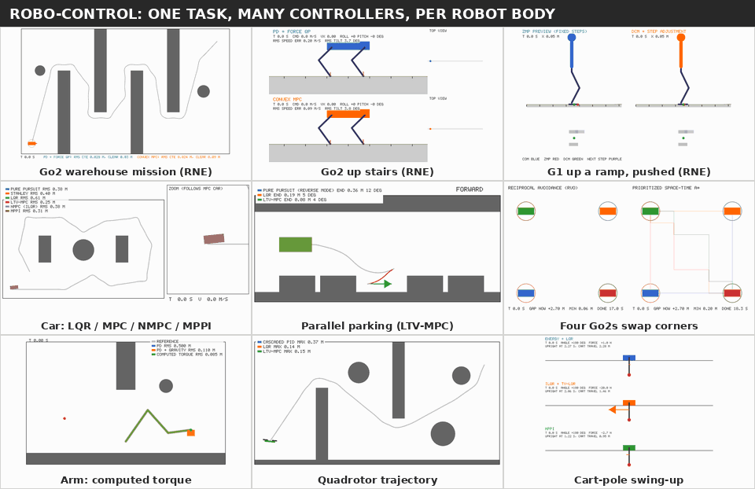

## Gallery by robot body

### Wheeled

| Differential-drive AMR | Car |
|:---:|:---:|
| 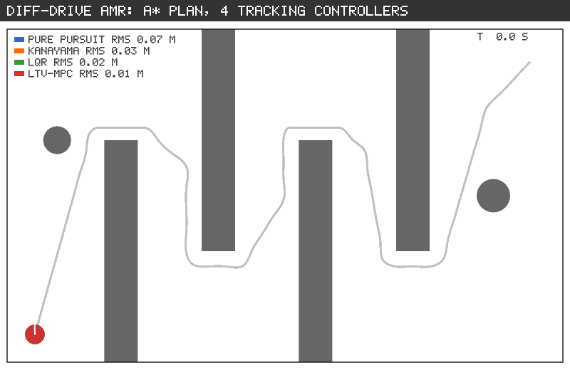 | 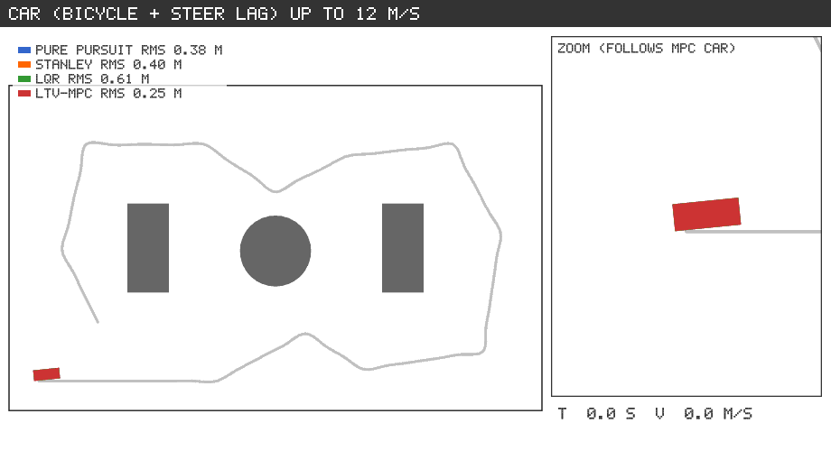 |
| A* -> spline -> speed profile in a warehouse; **pure pursuit / Kanayama / LQR / LTV-MPC** on a unicycle with velocity-loop lag | Fast spline circuit (up to 12 m/s) on a kinematic bicycle with steering lag; **pure pursuit / Stanley / LQR / LTV-MPC / nonlinear MPC (iLQR) / MPPI** |

| Car parking with reverse |
|:---:|
| 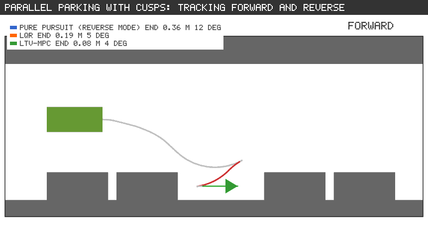 |
| Hybrid A* parallel-parking plan with cusps (red = reverse) turned into a signed-speed reference; **pure pursuit with a reverse mode / LQR / LTV-MPC** |

### Legged

| Quadruped (dog type) | Humanoid |
|:---:|:---:|
| 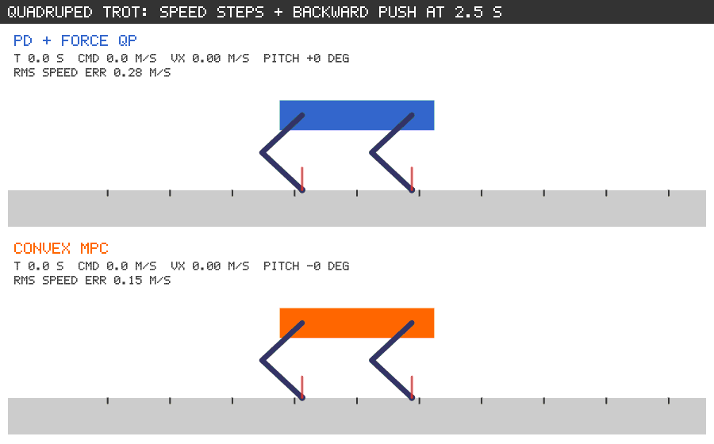 | 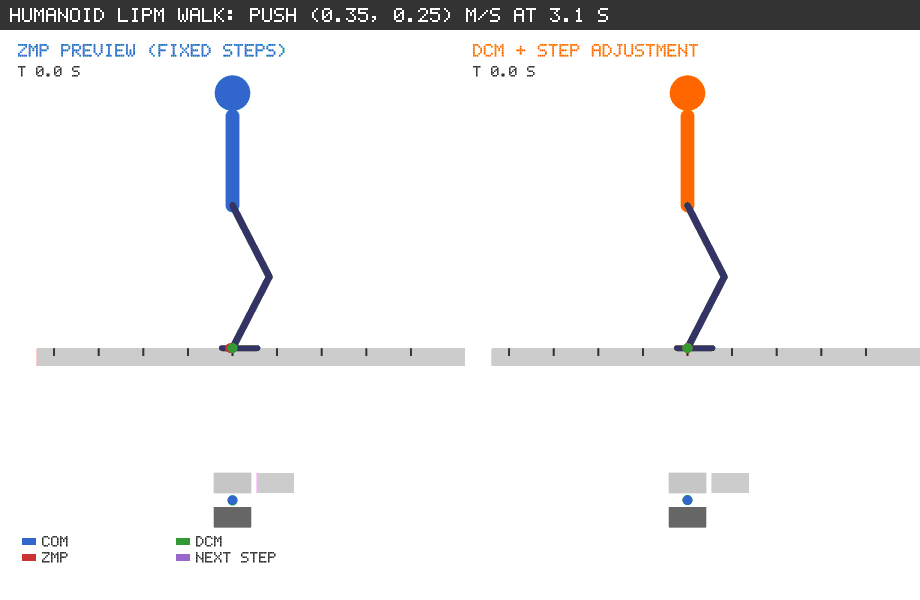 |
| Trot on a sagittal single-rigid-body model, speed steps and a 24 N s backward push; **PD + force-distribution QP vs convex MPC** over one gait cycle (3D versions run the articulated Go2, below) | 3D LIPM walking, 0.35 / 0.25 m/s push mid-step; **ZMP preview control on fixed footsteps falls, DCM control with step adjustment recovers** (the same walkers drive the articulated G1, below) |

### Manipulator, aerial, balancing

| Arm | Drone | Cart-pole |
|:---:|:---:|:---:|
| 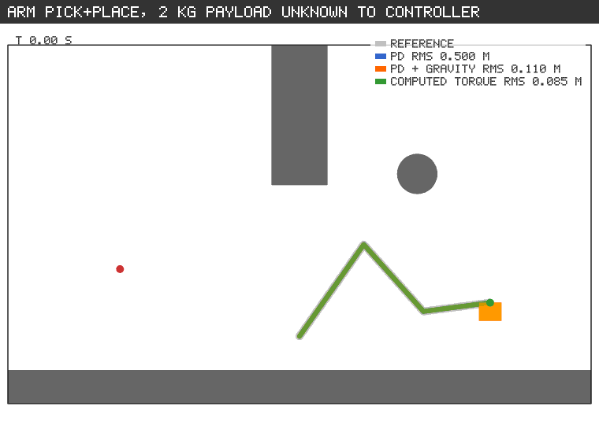 | 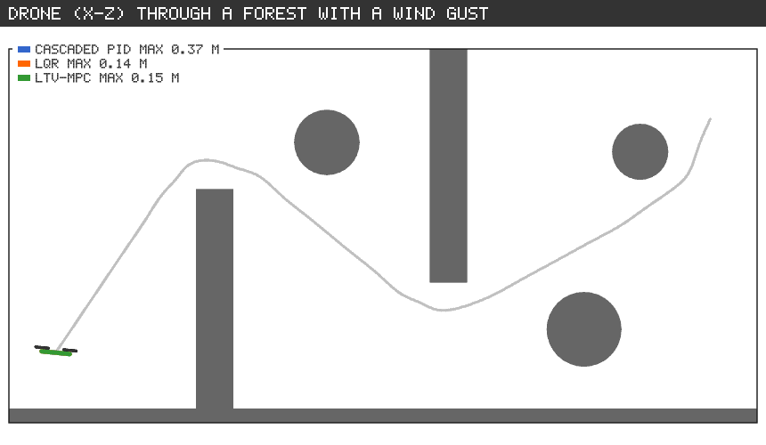 | 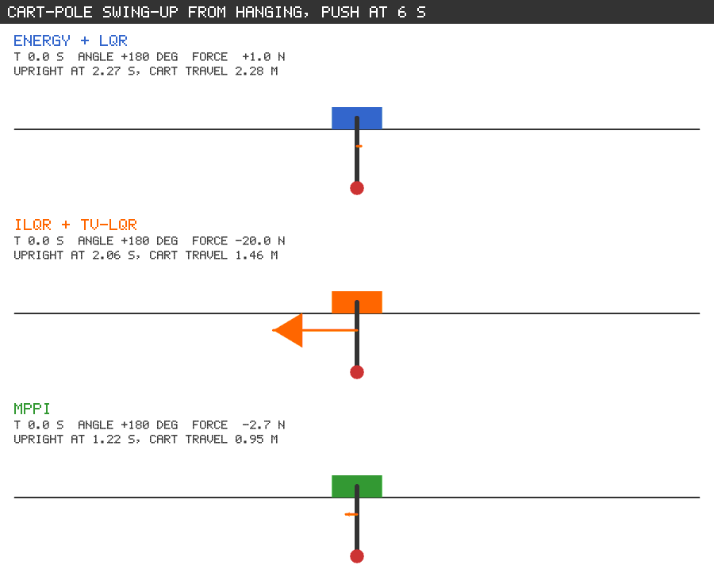 |
| RRT-Connect pick-and-place with a 2 kg payload the controllers do not know; **PD / PD + gravity / computed torque** | RRT* path through a forest with a wind gust; **cascaded PID / LQR / LTV-MPC** | Swing-up from hanging and a push; **energy shaping + LQR vs iLQR + TV-LQR vs MPPI** |

```bash
cargo run --release --example body_gallery              # all GIFs + metric tables -> out/bodies/
cargo run --release --example body_gallery humanoid     # one of: amr car quadruped humanoid arm drone cartpole
```

## On Robot Native Engine: articulated Unitree Go2 and G1

The same controllers also run on the full articulated robots of
[Robot Native Engine](https://github.com/rsasaki0109/RobotNativeEngine) (RNE),
in the `rne/` crate (`robo-control-rne`, RNE pinned to commit `3ed43d0` (main)):
RNE's hard-contact floating-base dynamics (`rne_dynamics::contact_step`) is
the plant, robo-control decides.

| Go2 (12 DoF) | G1 (12-DoF legs) |
|:---:|:---:|
| 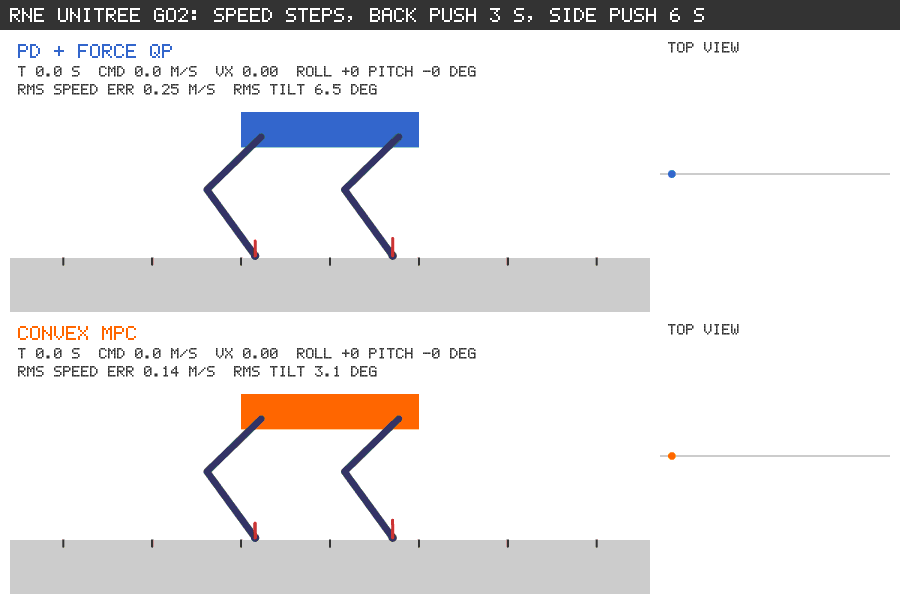 | 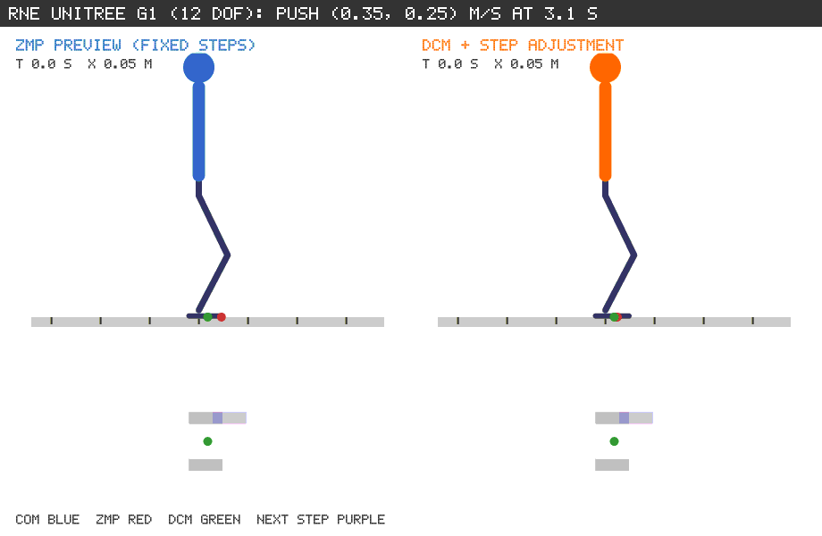 |
| `legged3d::PdForceQp` vs `legged3d::ConvexMpc3d` choose the stance forces, applied as `-J^T f` on RNE's `Quadruped`; swing feet land at Raibert footholds through its leg IK. 0.5 then 1.0 m/s, a 120 N back push and a 100 N side push. | `scenarios::humanoid::LipmWalker` (ZMP preview on fixed steps vs DCM step adjustment, the same walker as the point-mass scenario) drives RNE's whole-body controller (`rne_wbc`, contact cones enforced); four sole contacts per foot. |

| Go2 on rough terrain | Go2 up stairs | G1 up a ramp |
|:---:|:---:|:---:|
| 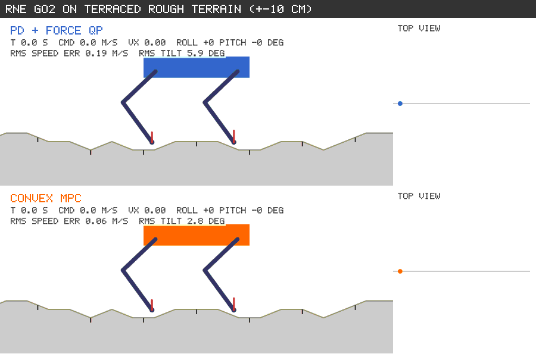 | 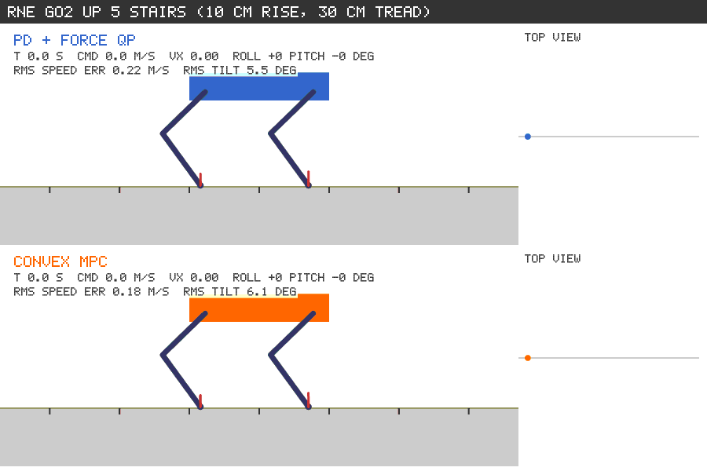 | 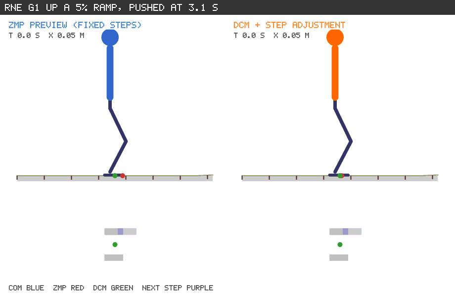 |
| Seeded fractal terrain, +-10 cm with 4 cm terraces under the path: footholds and the ride height follow the ground. | Five 8 cm steps with 30 cm treads (a 1 cm height field, so the risers are near vertical); swing apex 12 cm. | A 5 % ramp up to 6 cm, pushed mid-climb: contacts, swing heights and the CoM height follow the ground. |

| Planning + control: Go2 crosses the warehouse |
|:---:|
| 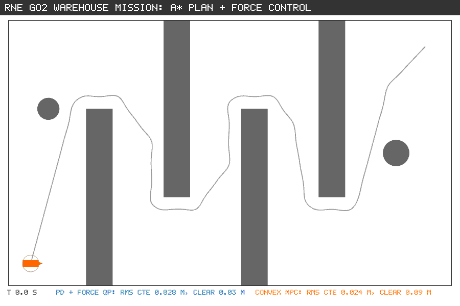 |
| robot-planning plans the route on its warehouse scene (A* on a grid inflated by the Go2's 0.38 m footprint, line-of-sight pruning, a spline and a speed profile capped at 0.7 m/s and 0.4 m/s^2 lateral). The Go2 is commanded the reference velocity plus position feedback, and faces along the path (heading and yaw rate from the tangent and curvature). PD + force QP (blue) vs convex MPC (orange) walk the 63 s route; both arrive on schedule, and the MPC holds tighter in the turns (max cross-track 5 cm vs 16 cm) and keeps more clearance from the shelves. |

| G1 walks the same warehouse route |
|:---:|
| 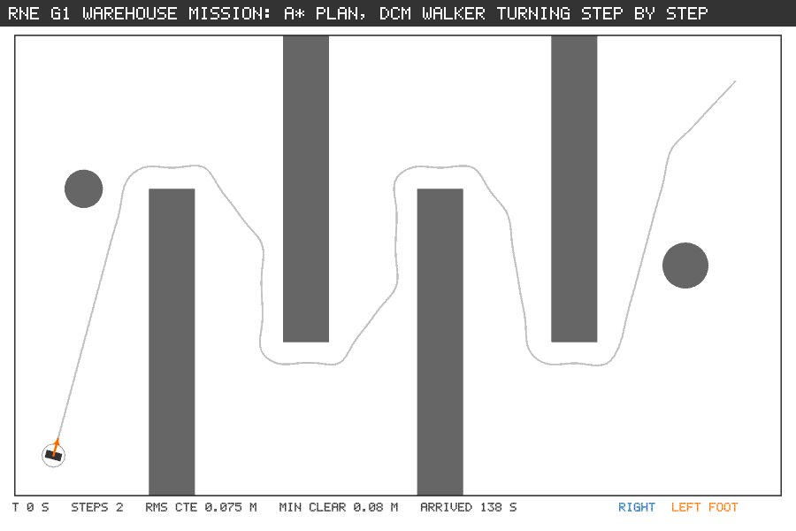 |
| The humanoid on the same A* route, slowed to a G1 speed profile (0.27 m/s, 0.08 m/s^2 lateral). `LipmWalker` now turns by footsteps: each step rotates the foot by up to 0.2 rad toward a commanded heading, and the DCM footstep and ZMP laws run in the walking frame. On RNE the swing sole, the support rectangle used to clamp the ZMP, and the pelvis attitude target all follow the feet's yaw. The walker is steered toward a point 0.6 m ahead on the route, taking its step length from the speed profile: 366 steps, no fall, 7.5 cm RMS from the route, at least 8 cm from every shelf. |

| Go2 among people and a cart |
|:---:|
| 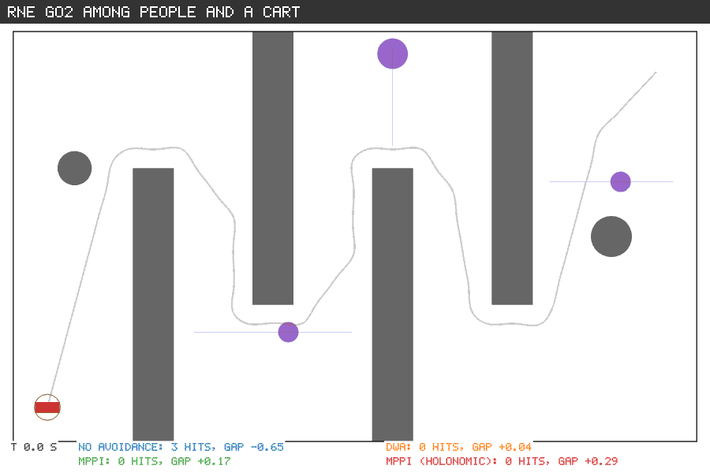 |
| Four Go2 runs overlay the same warehouse route with two people and a cart (purple) on fixed back-and-forth routes. Blue follows the timed plan, orange uses robot-planning's DWA, green uses MPPI with a unicycle model, and red uses MPPI with independent forward and lateral body velocities. DWA tests constant-velocity arcs. Both MPPI variants sample input sequences with a 10 cm safety margin, and the holonomic variant adds a small cost for lateral commands. All three local planners predict the movers at constant velocity. The movers are kinematic discs, and contact is measured by distance. The Go2 walks with convex MPC on RNE throughout. |

| Four Go2s swapping corners |
|:---:|
| 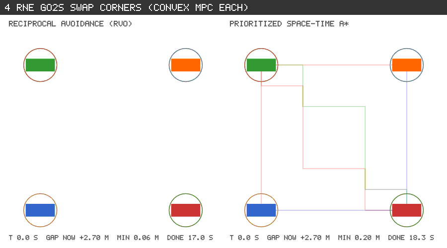 |
| Each Go2 trots with its own convex MPC on RNE; velocity commands come from robot-planning's multi-robot methods: decentralised reciprocal avoidance (left) vs prioritized space-time A* with a 0.9 m separation (right). The robots run in separate simulations, so the separation they keep is what is measured. |

```bash
cargo run --release -p robo-control-rne --example rne_gallery     # out/rne/{go2,g1,go2_terrain,go2_stairs,g1_ramp,fleet,go2_mission,go2_crowd,g1_mission}.gif + metrics
cargo test --release -p robo-control-rne                          # asserts the results below
```

#### Go2 on RNE

| controller | fell | rms_speed_err_mps | rms_height_err_m | rms_tilt_rad | lateral_drift_m | distance_m |
|---|---|---|---|---|---|---|
| PD + force QP | 0.000 | 0.252 | 0.005 | 0.113 | 0.282 | 3.468 |
| convex MPC | 0.000 | 0.143 | 0.009 | 0.055 | 0.143 | 4.473 |

#### G1 on RNE

| controller | fell | fall_time_s | rms_speed_err_mps | distance_m | lateral_drift_m |
|---|---|---|---|---|---|
| ZMP preview (fixed steps) (push) | 1.000 | 4.040 | 0.175 | 0.758 | 0.569 |
| DCM + step adjustment (push) | 0.000 | NaN | 0.060 | 2.071 | 0.265 |
| ZMP preview (fixed steps) (no push) | 1.000 | 4.966 | 0.021 | 1.018 | 0.578 |
| DCM + step adjustment (no push) | 0.000 | NaN | 0.033 | 1.999 | 0.177 |
| DCM + step adjustment (push, ForceQpWbc) | 0.000 | NaN | 0.079 | 2.251 | 0.094 |

#### Go2 on terraced rough terrain (no pushes)

| controller | fell | rms_speed_err_mps | rms_height_err_m | rms_tilt_rad | lateral_drift_m | distance_m |
|---|---|---|---|---|---|---|
| PD + force QP | 0.000 | 0.191 | 0.006 | 0.103 | -0.214 | 3.790 |
| convex MPC | 0.000 | 0.064 | 0.006 | 0.048 | -0.175 | 4.623 |

#### Go2 up five 8 cm stairs

| controller | fell | rms_speed_err_mps | rms_height_err_m | rms_tilt_rad | lateral_drift_m | distance_m |
|---|---|---|---|---|---|---|
| PD + force QP | 0.000 | 0.201 | 0.015 | 0.065 | 0.035 | 4.459 |
| convex MPC | 0.000 | 0.086 | 0.026 | 0.067 | -0.017 | 5.491 |

#### G1 up the 5 % ramp (pushed)

| controller | fell | fall_time_s | rms_speed_err_mps | distance_m | lateral_drift_m |
|---|---|---|---|---|---|
| ZMP preview (fixed steps) (ramp, push) | 1.000 | 4.040 | 0.190 | 0.757 | 0.571 |
| DCM + step adjustment (ramp, push) | 0.000 | NaN | 0.057 | 2.361 | 0.150 |

#### Go2 warehouse mission (A* + spline plan, 63 s)

| controller | fell | rms_cte_m | max_cte_m | min_clearance_m | arrival_s | plan_duration_s | goal_err_m |
|---|---|---|---|---|---|---|---|
| PD + force QP | 0.000 | 0.028 | 0.157 | 0.031 | 63.528 | 63.579 | 0.000 |
| convex MPC | 0.000 | 0.024 | 0.052 | 0.089 | 62.574 | 63.579 | 0.029 |

#### G1 warehouse mission (DCM walker, footstep turning)

| controller | fell | rms_cte_m | max_cte_m | min_clearance_m | arrival_s | plan_duration_s | goal_err_m | steps |
|---|---|---|---|---|---|---|---|---|
| DCM + step adjustment | 0.000 | 0.075 | 0.231 | 0.083 | 137.580 | 155.028 | 0.142 | 366 |

#### Go2 among people and a cart (convex MPC walking)

At the default cart phase of 6.0 s:

| method | fell | contacts | contact_s | min_gap_m | min_shelf_clearance_m | arrival_s |
|---|---|---|---|---|---|---|
| no avoidance | 0.000 | 3.000 | 4.612 | -0.650 | 0.076 | 62.556 |
| DWA | 0.000 | 0.000 | 0.000 | 0.039 | 0.035 | 98.978 |
| MPPI | 0.000 | 0.000 | 0.000 | 0.173 | 0.188 | 91.994 |
| MPPI (holonomic) | 0.000 | 0.000 | 0.000 | 0.288 | 0.197 | 80.010 |

In the lower passage, the holonomic run shifted sideways while moving forward and kept 0.288 m from the oncoming person, compared with 0.173 m for unicycle MPPI. It still slowed and briefly backed up at the open-bay crossing before walking past the second person.

Over all eight cart phases (0.0, 1.4, 2.8, 4.2, 5.6, 7.0, 8.4 and 9.8 s):

| method | runs | runs_with_contact | contacts | worst_min_gap_m | arrived | mean_arrival_s | falls |
|---|---|---|---|---|---|---|---|
| no avoidance | 8 | 8 | 19 | -0.651 | 8 | 62.6 | 0 |
| DWA | 8 | 1 | 1 | -0.468 | 8 | 82.4 | 0 |
| MPPI | 8 | 0 | 0 | 0.173 | 8 | 83.4 | 0 |
| MPPI (holonomic) | 8 | 0 | 0 | 0.288 | 8 | 81.9 | 0 |

Both MPPI variants completed all eight runs without contact. The holonomic variant averaged 81.9 s versus 83.4 s for unicycle MPPI. At the 8.4 s cart phase it took 82.744 s versus 82.428 s for unicycle MPPI.

#### Four Go2s swapping corners

| controller | min_separation_m | all_arrived_s | max_final_err_m | fallen |
|---|---|---|---|---|
| reciprocal avoidance (RVO) | 0.057 | 17.000 | 0.016 | 0.000 |
| prioritized space-time A* | 0.200 | 18.300 | 0.022 | 0.000 |

What carried over and what did not:

- **Go2**: both force controllers trot the articulated robot unchanged. The
  convex MPC tracks speed better (0.14 vs 0.25 m/s RMS, including both pushes)
  and stays more level after the side push (3 vs 6.5 degrees RMS tilt).
- **G1**: DCM step adjustment walks 8 s and absorbs the same push as the
  point-mass scenario. ZMP preview control on fixed footsteps falls sideways
  after about 9 steps *even without the push* (4 s with it): on the real leg
  dynamics each footfall lands a little off, and moving the ZMP inside a
  5 cm-wide sole cannot absorb the accumulated error without moving the feet.
  In the point-mass scenario, where swing legs are perfect, it only fails
  under the push.
- **Stairs**: the Go2 climbs five 8 cm steps (0.4 m) with either force controller for any swing apex from 10 to 14 cm, and the MPC tracks speed far better on the way (0.09 vs 0.20 m/s RMS). 10 cm steps are marginal: both climb with a 10 cm apex, but the MPC falls with 12-14 cm; 12 cm steps defeat both. Its point feet need no foothold selection, which is exactly what the G1 lacks (below).
- **Terrain**: both Go2 controllers trot over +-10 cm terraced terrain (the MPC with half the tilt); the G1 with DCM stepping climbs a 5 % ramp through the push while fixed footsteps fall. Stairs are not there yet, for a geometric reason. With edges midway between footholds the sole clears an edge by step/2 - 0.085 m: 1.5 cm at 0.2 m steps, while the swing feet land within about 3 cm. A safe margin needs steps of 0.25 m or more, which this G1 controller does not walk stably even on the flat. Tread-centred footholds (with hysteresis), riser contacts with a horizontal normal and a task-space swing-foot task were all tried; none made the climb robust, so none is shipped.
- **Fleet**: both methods bring the four Go2s home without overlap. Reciprocal avoidance squeezes past at 6 cm and finishes first (17.0 s); prioritized planning keeps its reserved 0.9 m separation (0.2 m of air) and takes 18.3 s. On a 0.5 m grid it first planned overlapping robots, which is why `prioritized_plan` now takes a separation larger than one cell.
- **Warehouse**: planning and control end to end. The Go2 follows the route with either force controller, and the convex MPC holds tighter in the turns (5 vs 16 cm). The G1 needed the walker to turn by footsteps, and the swing sole, ZMP support and pelvis to follow the feet's yaw; with that it walks the whole route (366 steps). Among moving people and a cart, both MPPI variants completed all eight cart timings without contact. The holonomic variant kept a larger minimum gap. DWA froze once when cornered and was walked into.
- Three things were needed beyond the point-mass walker: telling the walker
  where each foot actually landed (`LipmWalker::set_stance_position`),
  switching support on measured contact rather than on the clock, and a
  whole-body controller that keeps contact forces physical.
- That last one was fixed in RNE itself ([#553](https://github.com/rsasaki0109/RobotNativeEngine/pull/553)): `rne_wbc` used to solve
  forces and accelerations unconstrained and project the forces onto the
  friction cones only afterwards, so its torques could assume a sole edge
  pulling on the ground; the G1 fell after 2.6 s with it. The new
  `WholeBodyConfig::enforce_contact_cones` keeps the forces in friction
  pyramids inside the solve, and its bounded solver is now an exact active-set
  method (the old one supported only 114 N of a standing G1's 315 N with
  `enforce_torque_limits`). The G1 here runs on that. `rne::g1::ForceQpWbc`, an
  independent force-QP + inverse-dynamics controller written before the fix,
  is kept as a cross-check (last row).

## Which controller for which body?

| Body | Model (`models`) | Controllers | Where |
|---|---|---|---|
| Differential drive | `Unicycle` (x, y, yaw, v, w with first-order velocity loops) | pure pursuit, Kanayama, LQR, LTV-MPC (DWA in robo-planning) | `controllers::path_tracking`, `lqr`, `mpc` |
| Car | `Bicycle` (kinematic, rear axle, steering lag) | pure pursuit, Stanley, LQR, LTV-MPC, NMPC, MPPI | same, `mppi` |
| Quadruped | single rigid body + massless legs (`scenarios::quadruped` 2D, `legged3d` 3D) | PD wrench + force-distribution QP, convex MPC, Raibert foot placement | `scenarios::quadruped`, `legged3d` |
| Humanoid | 3D linear inverted pendulum with ZMP inside the foot (`scenarios::humanoid`) | ZMP preview control (Kajita) + DCM stabilizer, DCM / capture-point control with step adjustment (`LipmWalker`) | `scenarios::humanoid` |
| Serial arm | `PlanarArmDyn` (N links, recursive Newton-Euler, payload, friction) | PD, PD + gravity compensation, computed torque | `controllers::arm` |
| Drone | `Quadrotor2D` (x-z, two rotors) | cascaded PID, LQR, LTV-MPC with flatness-based feed-forward | `controllers::quadrotor` |
| Inverted pendulum | `CartPole` | energy swing-up + LQR, iLQR + TV-LQR, MPPI | `controllers::cartpole`, `ilqr`, `mppi` |

Generic building blocks work with any `model::Dynamics`: RK4 integration and
finite-difference linearisation (`model`), DLQR and tracking LQR (`lqr`),
LTV-MPC with a FISTA box-constrained QP and nonlinear MPC on iLQR (`mpc`),
sampling-based MPPI (`mppi`), iLQR with time-varying references (`ilqr`), and the
closed-loop simulator with disturbances and seeded noise (`sim`).

## Results

Generated by `body_gallery` (also written to `out/bodies/README.md`).

#### amr

| controller | rms_cte_m | max_cte_m | goal_err_m | time_s | min_clearance_m |
|---|---|---|---|---|---|
| pure pursuit | 0.075 | 0.278 | 0.011 | 39.260 | -0.052 |
| Kanayama | 0.031 | 0.093 | 0.011 | 40.500 | 0.084 |
| LQR | 0.019 | 0.059 | 0.037 | 39.260 | 0.096 |
| LTV-MPC | 0.007 | 0.022 | 0.002 | 39.340 | 0.100 |

#### car

| controller | rms_cte_m | max_cte_m | goal_err_m | time_s | min_clearance_m |
|---|---|---|---|---|---|
| pure pursuit | 0.377 | 1.058 | 1.121 | 53.980 | 4.843 |
| Stanley | 0.402 | 1.353 | 0.868 | 53.980 | 4.307 |
| LQR | 0.615 | 2.228 | 0.015 | 48.100 | 3.704 |
| LTV-MPC | 0.247 | 1.026 | 0.007 | 48.020 | 4.402 |
| NMPC (iLQR) | 0.384 | 1.485 | 0.007 | 48.020 | 4.089 |
| MPPI | 0.309 | 1.038 | 0.042 | 48.620 | 4.440 |

#### quadruped

| controller | rms_speed_err_mps | rms_height_err_m | rms_pitch_rad | fell |
|---|---|---|---|---|
| PD + force QP | 0.279 | 0.000 | 0.004 | 0.000 |
| convex MPC | 0.155 | 0.003 | 0.012 | 0.000 |

#### humanoid

| controller | fell | fall_time_s | rms_speed_err_mps | zmp_saturated_frac |
|---|---|---|---|---|
| ZMP preview (fixed steps) | 1.000 | 4.635 | 0.062 | 0.556 |
| DCM + step adjustment | 0.000 | NaN | 0.061 | 0.051 |

#### arm

| controller | rms_ee_err_m | max_ee_err_m | final_ee_err_m | min_link_clearance_m |
|---|---|---|---|---|
| PD | 0.500 | 1.131 | 0.188 | -0.150 |
| PD + gravity | 0.110 | 0.229 | 0.095 | 0.064 |
| computed torque | 0.085 | 0.133 | 0.085 | 0.088 |

#### drone

| controller | rms_path_err_m | max_path_err_m | rms_pos_err_m | min_clearance_m |
|---|---|---|---|---|
| cascaded PID | 0.144 | 0.368 | 0.273 | 0.059 |
| LQR | 0.033 | 0.137 | 0.086 | 0.192 |
| LTV-MPC | 0.029 | 0.146 | 0.131 | 0.200 |

#### parking

| controller | rms_cte_m | max_cte_m | final_pos_err_m | final_yaw_err_deg | contact_steps |
|---|---|---|---|---|---|
| pure pursuit (reverse mode) | 0.068 | 0.206 | 0.355 | 11.514 | 0.000 |
| LQR | 0.165 | 0.299 | 0.188 | 4.704 | 407.000 |
| LTV-MPC | 0.030 | 0.095 | 0.077 | 4.437 | 0.000 |

#### cartpole

| controller | time_to_upright_s | max_cart_travel_m | final_angle_rad | effort_n2s |
|---|---|---|---|---|
| energy + LQR | 2.270 | 2.275 | 0.009 | 178.802 |
| iLQR + TV-LQR | 2.060 | 1.463 | 0.009 | 256.109 |
| MPPI | 1.220 | 0.948 | 0.015 | 1077.263 |

Notes on reading the numbers:

- AMR: pure pursuit cuts corners (its minimum clearance is negative: it grazes a shelf); MPC tracks within 2 cm.
- Car: path-based pure pursuit and Stanley slow down on their own and stop short of the goal; time-based LQR and MPC follow the speed profile. LQR without preview cuts hairpins at speed. Nonlinear MPC does not beat LTV-MPC here: the reference is smooth, so linearising about it is already accurate, and a few iLQR iterations per step converge less tightly than the QP. MPPI, with no derivatives at all, lands between them.
- Parking: all three follow the cusps; LTV-MPC parks within 8 cm and 4 degrees. LQR tracks the path closely but cuts into the kerb or the parked car near the slot (contact steps), which a time-based tracker without preview does at low speed with steering lag.
- Cart-pole: MPPI swings up fastest (1.2 s) with the least cart travel but spends 4-6x the effort: sampling noise shows up as chatter in the force.
- Arm: PD alone sags into the floor (negative clearance) under the unknown payload; computed torque still keeps a small steady error from the payload because it has no integral action.
- Quadruped: the push is simulated as an external force on the body; ground forces are the commanded ones clipped to unilateral contact and the friction cone (no foot slip).
- Humanoid: a fall is declared when the CoM is more than 0.55 m from the stance foot.

## Development

```bash
cargo fmt --all
cargo clippy --all-targets -- -D warnings
cargo test        # every scenario's headline result is asserted in tests/scenarios.rs
cargo test --release -p robo-control-rne   # Go2 / G1 on RNE (first build fetches and compiles RNE, ~4 min)
```

Everything is deterministic: fixed-step RK4 / semi-implicit Euler, no wall clock,
seeded noise.

The hero GIF at the top tiles the gallery GIFs in `docs/media/` (needs Pillow; see the
script's docstring for the arguments):

```bash
python3 scripts/hero_gif.py docs/media/hero.gif "TITLE" docs/media/a.gif:"Caption" ...
```

## License

MIT OR Apache-2.0
